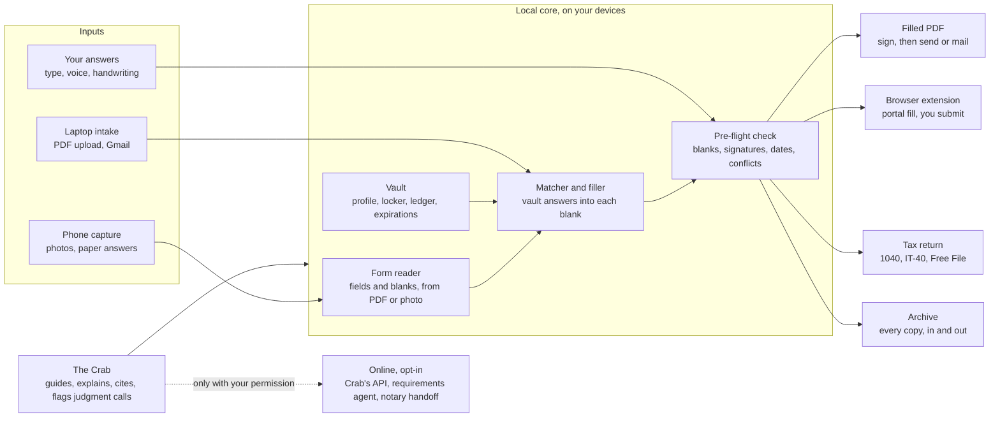

# Form Filler: build plan

Restated 2026-11-17 from the plan document kept on claude.ai (as it stood that evening, with its privacy wall and the
Crab on the page), which stays the source of truth. This copy lives with the
code so each phase can be checked against it. Two things were left out on purpose because this repository is public:
the link to that document, and what in it is one person's own (addresses, tax situation, decisions that are theirs
alone, and the names of private projects). Where this file and the document differ, the document wins.

The plan's outside facts (the status of IRS Direct File, what the Fact Graph covers, state rules) are repeated here as
the plan states them. They were **not re-checked** in phase 1.

Where the code stands against this plan: [INVENTORY.md](INVENTORY.md). How phase 2 would be built:
[PHASE2_PROPOSAL.md](PHASE2_PROPOSAL.md).

## What it becomes

Form Filler becomes a personal paperwork office. It reads any form, fills what it already knows, walks you through the
rest with a guide called the Crab, checks the work, and remembers what you sent.

- **The laptop is the main desk**: a Tauri shell on macOS.
- **The phone is the camera**: an installable web app for capture, the paper-answers workflow and quick fills.
- **A Chrome extension** fills web portals.

The north star is your own taxes: documents gathered all year, the return assembled from them, the Crab explaining
each line, and you reviewing and signing instead of building it from scratch.

### Three rules and one promise

1. **Local first.** Your data lives encrypted on your devices. Anything that goes online is opt-in and shows what is
   being sent.
2. **Nothing is signed or submitted without your click.**
3. **Every filled answer can be traced** to where it came from: your profile, a document in the locker, something you
   typed, or something the Crab suggested and you accepted.

**The promise:** every document that comes in or goes out is kept, exact and organized, in an archive you own.

## Privacy wall: what never leaves your Mac

GitHub holds the code; your information stays on your devices. The page downloads code from GitHub and runs it
locally, and nothing you type is sent back. The wall below makes sure it stays that way, including by accident.

1. **Data lives outside the repo.** The vault and `~/Form Filler Archive/` sit where git cannot see them.
2. **Never-list commit gate.** A pre-commit hook, and the same check in CI, blocks any commit matching the never-list:
   your name, birthdate, addresses, SSN and licence-number shapes, routing and account numbers. The repo holds only
   patterns; your real values sit in a local, git-ignored file. **This gate goes in before any other phase 2 code.**
3. **Fake data only.** Tests, screenshots and README examples use invented people. Real documents never become
   fixtures.
4. **The Crab never holds the key.** The part of the app that talks to an AI cannot decrypt the vault, the same way
   Silenus cannot reach your keys. It gets field labels and only the values you approve per form; never-list items are
   stripped before anything leaves.
5. **On-screen masking.** Never-list fields show the last four characters until you reveal them.
6. **No shared browser storage.** The live github.io page shares storage with your other github.io pages. The Mac app
   removes that, and the web version encrypts what it stores.

Status: item 2 is built (the first commit of phase 2; see [never-list/README.md](../never-list/README.md)), and goes
one step further than the wording above: the local file holds no real value, only a keyed fingerprint of each. Items 1, 5
and 6 are part of phase 2 ([PHASE2_PROPOSAL.md](PHASE2_PROPOSAL.md)); item 4 binds phase 4; item 3 is already how the
repository works, and the gate now enforces it for pictures and PDFs. Item 6's web half is built: since 2.6.0 the web
version encrypts what it stores, and since 2026-11-21 the live page has a web address of its own,
`formfiller-app.github.io`, so it no longer shares storage with your other github.io pages. The Mac app is still to
come.

## Architecture

Everything runs locally. Only the Crab reaches out, and only when you allow it.



Inputs from the phone, the laptop and your own answers feed one local core. The vault supplies what it already knows,
pre-flight gates every output, and every output also lands in the archive.

## Build phases

Ordered so the archive exists before anything is sent, and so the taxes lane is usable by the 2027 filing season
(which by past pattern opens in late January). **Each phase ends with a check you run yourself on a real document.**

The shortest path to filing your own taxes is phases 1, 2, 3, 4 and 8 (filing by mail). The extension in phase 7 adds
the e-file route.

| # | Phase | What gets built | The check |
| --- | --- | --- | --- |
| 1 | **Inventory the repo** | Read what the repository already does. List what works, what is partial, what is missing. | A written inventory that matches the running app. |
| 2 | **Shell, vault, archive, backup** | A Tauri shell on the Mac for real file-system access. The encrypted vault (profile, locker). The archive folder and its index. An encrypted backup snapshot to an external drive or chosen folder. | Wipe the app's data, restore from the backup, and everything comes back. |
| 3 | **Any PDF on the laptop** | Fillable forms (AcroForm fields) and flat PDFs where the boxes are only drawn: render with pdf.js, detect boxes and lines with OpenCV.js. Match blanks to the vault, fill, run pre-flight, export flattened, archive the result. | A real IRS fillable form and a real flat onboarding form, every blank filled or flagged. |
| 4 | **Crab v1** | The Crab on the page: scuttles to each blank, talks from beside it, explains the field from the form's own instructions, asks only for what the vault lacks, and checks each entry with an honest badge (matches a source, well-formed, or can't check). | Complete a form you have never seen without leaving the app, and every badge it shows is true. |
| 5 | **Ledger and automatic capture** | The ledger of what went where. Gmail intake for incoming forms. A sweep of sent mail that files outgoing attachments. A watched `_Inbox` folder. Signature and initials placement. Expiration countdowns. | E-mail a form, then find it filed in the archive with the cover e-mail, and later the reply, without filing anything by hand. |
| 6 | **The phone** | Installable web app: capture, perspective correction, the number-plus-answer paper workflow, handwriting with a mandatory review screen, voice answers. Pairs with the laptop by QR code over the local network. | Photograph a paper form and get a correct PDF back after review, archived. |
| 7 | **Laptop browser extension** | Fills portals from the vault, saves progress so a timeout or crash loses nothing, leaves the submit click to you, archives the filled pages and the confirmation page. | Fill a real portal, kill the tab mid-form, restore, submit, and find the confirmation in the archive. |
| 8 | **Taxes lane** | See [Taxes lane](#taxes-lane). | Rebuild your last filed return from its source documents and match it line by line. |
| 9 | **Packet builder** | "They want these 14 things" becomes one ordered, filled packet from the locker. | A real onboarding packet. |
| 10 | **Online layer (opt-in)** | A requirements agent that cites official sources, a remote-notary handoff, a hold-time agent. | Every requirement it states links to the official page. |

Status: phase 1 is done (branch `phase-1-inventory`). Phase 2 has started on branch `phase-2` with the never-list
gate and "slice 0" (the reader's defects in WebKit, older browsers and long PDFs). The Tauri shell's throwaway spike
has run ([SHELL_SPIKE.md](SHELL_SPIKE.md)); of the shell itself the groundwork is built on branch `phase-2-shell`
(the app, its file interface and its checks), and its screens have not started. The archive is built as a library and a
command (2.5.0, slice 2), the vault, which keeps the web page's details and signature locked (2.6.0, slice 3), and
backup and restore, tested by wiping and restoring (2.7.0, slice 4).

## Archive: a copy of everything in and out

**This is a hard requirement.** Every document that comes in or goes out lands in one archive folder you own, filed by
matter, with the exact bytes that moved and a record of how they moved. It is a plain folder, readable without the
app, so your records outlive the software.

```
Form Filler Archive/
  Taxes/2026/
  Licensing/<licence>/
  Work/<employer>/<contract>/
  Housing/<address>/
  _Inbox/        (dropped files waiting to be read)
  _Unsorted/     (items the app could not place with confidence)
```

Each item is its own dated folder, for example `2026-11-17 sent IRS - Form 1040/`, holding:

- the original as received,
- the filled version,
- the exact copy sent,
- the cover e-mail,
- the confirmation,
- and later the reply.

A small `record.json` beside them notes direction, counterparty, channel, dates, the ledger entry, and a SHA-256
fingerprint of each file. A duplicate is caught, and "is this exactly what I sent?" has a yes-or-no answer.

**Two rules that never bend:**

- **Never auto-delete.** Nothing in the archive is ever removed by the app.
- **Never misfile.** Anything the app is not sure about waits in `_Unsorted`. Moving an item updates the index.

| Channel | How it is captured | Difficulty |
| --- | --- | --- |
| Anything exported from Form Filler | Filed automatically at export | Easy |
| Files you drop in or share from the phone | Watched `_Inbox` folder, read and filed | Easy |
| E-mail received (Gmail) | Intake reads new mail with attachments | Medium |
| E-mail sent (Gmail), even sent outside the app | A sweep of the sent folder files outgoing attachments with their cover e-mail | Medium |
| Web portals | The extension saves the filled pages and the confirmation page when you submit | Hard: every portal differs, and some confirm only by e-mail |
| Paper mail | A phone photo of what you mailed plus the tracking number | Manual, phone-assisted |
| Texts, fax, portals used without the extension | Not captured; the ledger shows the gap and you can add it by hand | Not automatic |

**Filing.** The app suggests a matter from the sender, the form type, and matters that already exist.

**The hard parts.** Tying a reply to what it answers is easy for e-mail threads and hard for portals and paper. Gmail
access needs either your own Google Cloud project with the Gmail API (the plan notes, unverified, that apps left in
testing mode may lose their sign-in after 7 days) or IMAP with an app password, which is simpler for a local app.

**Safety and retention.** The vault (profile and ID numbers) stays encrypted inside the app. The archive folder is
protected by the Mac's FileVault disk encryption and by the encrypted backup snapshot. The IRS generally wants tax
records kept at least three years, and longer in some cases.

## The Crab

The Crab is Form Filler's guide. It sits beside every form, explains what a field wants, asks for what is missing, and
tells you when something needs your judgment.

What it does:

- Walks a form blank by blank, or takes over and fills everything it can while you watch.
- Explains jargon in plain words, quoting the form's own instructions or the official publication.
- Tutors: "why does the IRS want this?" gets a real answer with its source.
- Catches problems before you send: a figure that does not match the W-2 in the locker, a date that conflicts with a
  licence.
- Keeps the ledger talking: "you sent this 19 days ago, here is a follow-up e-mail."

On the page:

The Crab lives on the form itself. It scuttles to the next blank or the missing box, perches beside it (never on top
of it), and talks from that spot in a small speech bubble: what goes here, why, and where to find it. When you finish
the box it checks your entry and either gives a quick nod and moves on, or stays put and tells you what is off.

- **How it moves.** Every blank already has page coordinates from the form reader (fillable fields carry their own;
  flat forms get them from box detection), so the Crab walks a short path between them with a few frames of leg
  motion. The page scrolls to follow it. Near an edge it flips to the other side of the box.
- **What "verified" means, honestly.** Each check carries one of three badges. *Matches a source*: the entry agrees
  with the W-2, licence or profile it should match. *Well-formed*: the format checks out (date, phone, ZIP,
  routing-number checksum, SSN shape) but nothing confirms the content. *Can't check*: no source exists, so it is on
  you. It never says "correct" when it only means well-formed.
- **Pace.** Guided mode goes blank by blank. "Fill what you know" lets it race through everything the vault covers,
  then walk you only to the gaps.
- **On the phone.** The screen is too small to perch, so the Crab docks at the bottom edge with a pointer to the box.
- **Calm settings.** Animation respects the Mac's reduce-motion setting, and you can switch the Crab to a still icon
  or hide it entirely.

How it is built:

- The same engine as the standalone Silenus: the API, caching and lightweight local models, so common questions get
  answered offline and cheaper over time.
- Its own register. Silenus is the trickster; the Crab is the precise one, because a joke answer on a tax line costs
  money.
- Its chat is text-message bubbles in a side panel that never covers the form.
- **Every claim carries its source behind a tap. When it cannot find one, it says so instead of guessing.**
- When it goes online it sends field labels and your question by default. Your actual values go only when you allow
  it for that form.

## Taxes lane

Form Filler prepares the return; filing goes through a door the IRS already runs. The plan records that the IRS's own
Direct File
[will not be available in Filing Season 2026](https://www.route-fifty.com/digital-government/2025/11/direct-file-wont-happen-2026-irs-tells-states/409322/),
and that whether it returns for 2027 is unknown.

**The engine.** The IRS open-sourced Direct File's tax logic as the
[Fact Graph](https://github.com/IRS-Public/fact-graph), a knowledge graph of tax law that runs in JavaScript. The
catch: the Direct File release [modeled tax law as of tax year 2024](https://github.com/bch/direct-file) and covered
simple returns. Tax year 2026 changes have to be added and tested here. The fallback is computing the forms' own line
logic directly. Either way the check is rebuilding a past filed return to the penny.

**All year.** W-2s, 1099s, 1098s, last year's return and anything deductible land in the locker as they arrive, from
e-mail or a phone photo. The Crab reads the boxes off each document and asks you to confirm.

**At filing time.** The Crab interviews you only for what the documents do not answer, the engine fills Form 1040 and
its schedules, and pre-flight compares against last year to flag big swings.

**Three ways out:**

1. E-file through [Free File Fillable Forms](https://www.irs.gov/newsroom/its-not-too-late-use-irs-free-file-today),
   the IRS's free web forms with no income limit. The browser extension fills it from the finished return; you review
   and click submit. This is the main path.
2. Print, sign and mail the filled IRS PDFs.
3. Hand a complete packet to a paid preparer.

**Indiana.** The IT-40 gets the same treatment, computed directly (the Fact Graph is federal only). Indiana runs
[INfreefile](https://www.in.gov/dor/i-am-a/individual/infreefile/) through approved vendors; whether one of them can
take an extension fill needs checking. County tax is set by
[the county you lived in on January 1](https://www.in.gov/dor/files/dn01.pdf) and holds for the whole year.

**Other states.** Version 1 computes federal plus the Indiana return with the credit for tax paid elsewhere. Each
other state's return is prepared as a filled data packet and filed through that state's own free filing tool.

**Judgment calls stay yours.** A question that turns on your own circumstances gets flagged with the IRS publication attached.
It is never an answer the Crab supplies.

## Legal and safety

Nothing here blocks the build. Each row is a rule the design already follows or a line to stay behind. This is general
information, not legal advice.

| Area | The rule | What Form Filler does |
| --- | --- | --- |
| Electronic signatures | The federal ESIGN Act and UETA (Indiana adopted it) generally make e-signatures valid. Wills and some court and family-law papers are exceptions, and a recipient can still demand wet ink. | Flags forms likely to need a physical signature. Never signs without your action. |
| Tax e-filing | Transmitting returns to the IRS directly requires being an authorized e-file provider. | Prepares the return; you submit through Free File Fillable Forms, mail, or a preparer. |
| Preparing others' taxes | Preparing someone else's return for pay requires a preparer tax ID. Software people use on their own returns does not. | Stays a self-prep tool. |
| Legal advice | Telling a specific person how to make legal judgment calls can drift toward unauthorized practice of law. The line varies by state and is not settled. | The Crab explains and cites official sources; judgment calls are flagged as yours. |
| Remote notarization | Indiana has allowed [remote online notarization since July 1, 2019](https://www.docusign.com/products/notary/legality/indiana), through state-approved platforms. | Hands off to an approved platform; does not notarize. |
| Web portals | Filling fields for a user is ordinary autofill. Bots, CAPTCHA workarounds and automated submission can breach site terms, especially on government sites. | Fills, saves, restores. You click submit. |
| Your data | Data that stays on your device puts no breach duty on the developer. HIPAA does not cover a person's own records in a consumer tool. Cloud-synced health records could fall under the FTC's Health Breach Notification Rule. | Local and encrypted by default. Any sync is end-to-end encrypted, and that decision is revisited before it ships. |
| Phone and hold agent | Indiana is one-party consent for recording, but the other end may be in a two-party state. How the FCC's 2024 AI-voice ruling applies to calls you start yourself is unsettled. | Announces itself if it records; hands the call to you when a human picks up. |
| Public repo | Others will run this code on their paperwork. | A clear no-warranty licence and README; no default that sends data anywhere. |

## Rulings: defaults set, and what is still open

The build starts on these defaults.

| Decision | Default | Why |
| --- | --- | --- |
| App shell | Tauri on the Mac, installable web app on the phone, Chrome extension on the laptop | The archive and backups need real file-system access; one web codebase runs in all three |
| Phone–laptop sync | Local network, paired by QR code, plus an encrypted export file for away from home | Nothing goes through a cloud server |
| Crab's brain | Local models first; the API only when you allow it for that form | Routine help works offline; you see what leaves the machine |
| Crab and Silenus | One shared engine, two registers | Matches the standalone Silenus direction |
| Tax engine | IRS Fact Graph for federal, the forms' line logic as fallback; Indiana computed directly | Authoritative federal logic; state is not in the Fact Graph |

Still open, and the owner's to decide:

- [ ] **Other people.** Whether Form Filler is designed for anyone besides its owner from day one.
- [x] **Archive format.** Decided 2026-11-17: a plain folder, at `~/Form Filler Archive/` (not Documents, not iCloud),
      protected by FileVault and the encrypted backups.
- [ ] **Gmail connection.** Your own Gmail API project, or IMAP with an app password.
